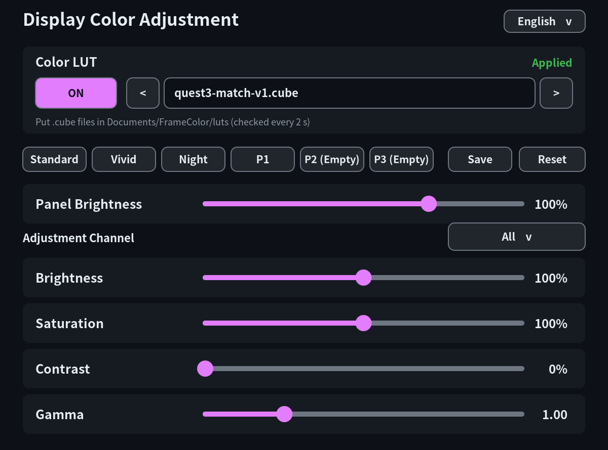

# FrameColor (unofficial fork)

[日本語](README.ja.md)

> **This is an unofficial fork of [beko-kerbecotton/framecolor](https://github.com/beko-kerbecotton/framecolor)**, not the original author's release. Please report problems in this repository's issues.
>
> Changes from the original:
> - **Color LUT**: pick `.cube` files placed in `~/Documents/FrameColor/luts/` and switch them on/off from the dashboard, live (no SteamVR restart). See [Color LUTs](EXTERNAL_LUT.md).
> - Includes a **measured LUT that brings the Frame's colors closer to a Quest 3**, switched on automatically on a first install: [luts/](luts/README.md)
> - Merges the two pull requests opened on the original repository ([#1 Vulkan layer chaining crash fix](https://github.com/beko-kerbecotton/framecolor/pull/1) and [#2 English/Japanese UI](https://github.com/beko-kerbecotton/framecolor/pull/2), both by brugr).
>
> It installs to the same locations as the original and replaces it if installed on top.



## Overview

FrameColor lets you adjust the Steam Frame's display colors from the SteamVR dashboard inside the headset. Alongside panel brightness, you can adjust brightness, saturation, contrast, and gamma globally or separately for the red, green, and blue channels. It includes Standard, Vivid, and Night presets, plus three slots for your own presets.

FrameColor is for Steam Frame only. Color correction is applied by a Vulkan layer loaded into SteamVR's `vrcompositor`. It affects locally run and streamed content, as well as the dashboard and other displayed elements.

## Requirements

- A Steam Frame (SteamOS, ARM64) using the stock SteamVR installation at `/opt/steamvr`
- A way to run one command on the Steam Frame (Konsole in desktop mode, or SSH from your PC)

Python 3, used during installation, comes with SteamOS. The release archive includes binaries built for Steam Frame. See “Development” for the tools needed to build from source.

## Installation

### Quick install (recommended)

Run this one line on the Steam Frame, either in Konsole in desktop mode or over SSH from your PC:

```sh
curl -fsSL https://github.com/kozutti/framecolor/releases/latest/download/get.sh | sh
```

It downloads the latest release, verifies its checksum, installs it, turns the correction on, and restarts SteamVR. The bundled color LUT (`quest3-match-v1.cube`) is also switched on for a first install. No `sudo` is needed.

To **update**, run the same line again. Adjustments, presets, and the LUT choice are kept. If you turned the correction off with `framecolorctl disable`, it stays off after updating.

To **uninstall**, run the following. Files in the LUT folder (`~/Documents/FrameColor/luts`) are kept.

```sh
sh ~/.local/share/framecolor-package/contrib/uninstall.sh
```

### Manual installation

Download `framecolor-VERSION-steamframe-aarch64.tar.gz` from GitHub Releases. If you want to verify its checksum, also download the matching `.sha256` file. Replace `VERSION` and `FRAME_IP` below with the release version and your Steam Frame's IP address.

From your PC, copy the archive to the Steam Frame's home directory:

```sh
scp framecolor-VERSION-steamframe-aarch64.tar.gz steamos@FRAME_IP:
```

To verify the checksum, also copy the `.sha256` file:

```sh
scp framecolor-VERSION-steamframe-aarch64.tar.gz.sha256 steamos@FRAME_IP:
```

Connect over SSH:

```sh
ssh steamos@FRAME_IP
```

Run the remaining commands on the Steam Frame. If you copied the `.sha256` file, verify the archive before extracting it:

```sh
sha256sum -c framecolor-VERSION-steamframe-aarch64.tar.gz.sha256
```

Then extract and install it:

```sh
tar -xzf framecolor-VERSION-steamframe-aarch64.tar.gz
cd framecolor
sh contrib/install.sh
~/.local/bin/framecolorctl enable
```

Run the installer as your regular user, without `sudo`. Vulkan correction is disabled immediately after a fresh installation. The final `enable` command enables both the correction and the dashboard, and restarts SteamVR. Installation uses only the user's `~/.local` and `~/.config` directories.

To update, download the new archive and run `sh contrib/install.sh` again using the same procedure. Saved adjustments and presets are retained. If correction is already enabled, the installer restarts SteamVR.

To remove FrameColor completely, run this from the extracted archive directory:

```sh
sh contrib/uninstall.sh
```

Uninstalling also deletes saved adjustments and presets. Panel brightness stored by SteamVR may remain. If necessary, use リセット (Reset) in the dashboard to return to the standard setting before uninstalling.

## Settings

Open “Display Color Adjustment” in the SteamVR dashboard.
You can switch the interface language between English and Japanese using the language drop-down menu in the top-right corner of the overlay panel.

| Control | Range | Applies to |
| --- | --- | --- |
| Panel brightness | 40–125% | SteamVR panel brightness setting; shared across channels |
| Brightness | 50–150% | Vulkan correction; global or per RGB channel |
| Saturation | 0–200% | Vulkan correction; global or per RGB channel; 100% is standard |
| Contrast | 0–100% | Vulkan correction; global or per RGB channel; 0% is standard |
| Gamma | 0.50–2.50 | Vulkan correction; global or per RGB channel; 1.00 is standard |

Under Adjustment Channel, choose All, Red, Green, or Blue. Moving a control with All selected changes the current values of all three channels together. Panel brightness is unaffected by the channel selection. To save the current settings, select Save and then P1, P2, or P3. Reset applies the Standard preset.

You can also use these commands over SSH:

```sh
~/.local/bin/framecolorctl status
~/.local/bin/framecolorctl doctor
~/.local/bin/framecolorctl disable
~/.local/bin/framecolorctl enable
~/.local/bin/framecolorctl language
```

`disable` turns off both Vulkan correction and the dashboard; `enable` turns them back on. Both commands restart SteamVR. `disable` does not delete saved adjustments or presets. If the display becomes hard to see, run `disable` over SSH.

### Color LUTs

Drop `.cube` files into `~/Documents/FrameColor/luts/`, then select one and toggle it live from the Color LUT card at the top of the dashboard. Selecting a file enables it. `~/.local/bin/framecolor-lut` also provides `list`, `select`, `on`, `off`, `status`, `validate`, and `install` commands. LUT changes do not need a SteamVR restart. RGB sliders and presets are applied after the LUT; return to the Standard preset to check the measured LUT by itself. See [Color LUTs](EXTERNAL_LUT.md) for details.

If SteamVR fails and exits within 10 seconds of starting, the startup guard disables the Vulkan layer after one failure by default. The failure may have a cause unrelated to FrameColor. You can instead allow up to three consecutive failures:

```sh
~/.local/bin/framecolorctl guard 3
~/.local/bin/framecolorctl guard 1
```

The guard cannot guarantee automatic recovery from every failure. Keep a way to recover manually over SSH.

## Disclaimer

FrameColor is an unofficial beta tool. SteamVR or SteamOS updates may break it.

Because correction is applied to the final display, it may also change the colors of the dashboard and safety boundaries. Avoid settings that significantly reduce visibility, and check that your surroundings are safe before use. This tool does not disable or modify safety boundaries.

This version supports only the stock SteamVR installation at `/opt/steamvr`. If something goes wrong, first run `~/.local/bin/framecolorctl disable` over SSH. Settings retained by SteamVR itself, such as panel brightness, may remain after correction is disabled. See [LICENSE](LICENSE) for the software's warranty disclaimer.

This tool was created with the assistance of Codex. It has been tested, but you use it at your own risk.

This fork's changes were made with the assistance of Claude and Codex. This fork is not affiliated with the original author, Valve, or Meta. Steam Frame and Quest are trademarks of their respective owners.

## Development

Build from source on the Steam Frame. You need CMake, Meson, Ninja, pkg-config, `glslangValidator`, development files for Cairo, FreeType, and Vulkan, and the `libopenvr_api.so` included with SteamVR. Creating a release archive also uses `strip`, `tar`, and `sha256sum`.

```sh
sh contrib/install.sh                 # Build from source and install to user directories
sh tests/test_guard.sh
sh tests/test_framecolorctl.sh
python3 -m unittest discover -s tests -v
sh contrib/package.sh VERSION        # Generate the archive and .sha256 file in dist/
```

If prebuilt binaries are not included, `contrib/install.sh` builds them from source. Run `contrib/package.sh` on a Steam Frame (ARM64). Generated `build/` and `dist/` directories are excluded from Git.

## Acknowledgments

The dashboard code and design are adapted from [frameeyeosc](https://github.com/sasaken1102r/frameeyeosc). The overlay uses headers from [OpenVR](https://github.com/ValveSoftware/openvr), and display color correction uses a modified version of [vkBasalt](https://github.com/DadSchoorse/vkBasalt). Thanks to their authors and contributors.

This fork is based on [FrameColor](https://github.com/beko-kerbecotton/framecolor) by beko-kerbecotton and includes pull requests #1 and #2 by brugr. Thank you.

FrameColor's original code is available under the [MIT license](LICENSE). See [Third-party notices](THIRD_PARTY_LICENSES.md) for details about third-party code and the original license texts.
